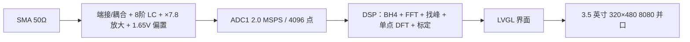

# G2026 — 周期信号测量分析装置

> 面向 10 kHz～500 kHz 周期信号的测量分析装置：**50 Ω 端接 + 8 阶抗混叠 + 2.0 MSPS 采样 +
> 单点 DFT 精化 + LVGL 界面**，在一块自研两层底板上完成从模拟前端到屏幕显示的完整链路。

| 指标 | 要求 | 实测最坏值 | 结论 |
|---|---|---|---|
| 基频误差 | ≤ 1 kHz | **0 Hz** | 满足 |
| 峰峰值误差 | ≤ 5 mV | **1.9 mV** | 满足（余量 2.6×） |
| 有效值误差 | ≤ 5 mV | **0.8 mV** | 满足（余量 6.3×） |
| 频率分辨率 | ≤ 500 Hz | **488.28 Hz** | 满足 |
| 单次测量 | ≤ 2 s | **约 0.25 s** | 满足（余量 8×） |
| 抗干扰 | 1 MHz / 200 mVpp | 带内**仅 2 根谱线** | 满足 |

> 测试口径：官方三组信号 + 11 项边界/组合场景 + 6 点干扰矩阵，共 14+6 项全部 PASS。
> 原始记录见 [`hardware/test/G2026-上板测试单-20261016-v5.xlsx`](hardware/test/G2026-上板测试单-20261016-v5.xlsx)。

## 系统一览



- **硬件**：STM32F407VGT6 核心板 + 自研两层底板；模拟/数字分区、AGND 独立岛、单点接地；
  21 只 33 Ω 源端阻尼贴 MCU 侧 2.5～2.9 mm。
- **软件**：Task / Operation / Device / Common 四层，业务逻辑不碰 HAL，可在 PC 上单元测试；
  FreeRTOS 三任务 + 1 深 mailbox；采样窗内 FSMC 零动作。
- **算法**：去均值 → BH4 窗 → 4096 点 CFFT → 门限找峰 → 抛物线/三点/单点 DFT 三步精化 →
  17 点对数频标定；`Upp` 用零相位重建，`Urms` 用 `√(ΣA²/2)`。

## 目录结构

| 位置 | 内容 |
|---|---|
| [`hardware/`](hardware/) | 硬件编号文档 58～67（机械尺寸、PCB 审查、运放稳定性、屏雪花根因、原理图/BOM、外壳定案）+ `data/` + `sch/`（原理图 PDF）+ `test/`（上板测试单） |
| [`firmware/`](firmware/) | 四层固件工程（CubeMX + CMake + FreeRTOS + LVGL）+ 规范手册 `firmware/docs/00~13` |
| [`tools/`](tools/) | 复算与仿真（`verify_dsp.py`、`sim/`）、工作区归位 |

进门先读：[`firmware/README.md`](firmware/README.md)（分层与构建）→ [`hardware/`](hardware/)（硬件口径与实测）。

## 快速开始（固件）

```bash
python firmware/Tools/fw.py env      # 工具链 / 探针 / 器件体检
python firmware/Tools/fw.py build    # 编译（--clean-first 为零告警口径）
python firmware/Tools/fw.py flash    # J-Link SWD 烧录
python firmware/Tools/fw.py rtt      # RTT 日志
python firmware/Tools/fw.py verify   # 门禁 + 烧录 + 抓标记，退出码即结论
```

不接板也能验证业务逻辑：

```bash
python firmware/Tools/fw.py test     # Operation 层 PC 侧单测
```

## 测试记录与文档说明

- **上板测试单**：[`hardware/test/G2026-上板测试单-20261016-v5.xlsx`](hardware/test/G2026-上板测试单-20261016-v5.xlsx)
  —— 官方三式、T1～T11、J1～J6 的逐项记录，含判据与结论。
- **固件规范**：`firmware/docs/00~13` —— 分层规则、构建门禁、日志与测试约定。
- **硬件口径**：`hardware/66`（原理图与 BOM，元件取值的唯一真相源）、`hardware/67`（外壳尺寸定案）。

毕业设计报告、软硬件导读讲义与补测清单不随本仓库公开（`docs/` 已排除，见 `.gitignore`）；
如需报告或复算明细，可通过 Issue 联系。

## 状态与边界

- ✅ **已上板验证**：显示、触摸、采样、算法、干扰抑制、测量时延。
- ⚠️ **未闭环项**：温漂与长时稳定性未测；三音以上与节点级波形未验证。
- 📄 本仓库为**公开版**：已移除内部文档（`docs/`）、AI 规则文件、编辑器本机配置与 3.7 GB
  厂商资料包；所有本机绝对路径已替换为相对路径或占位符。

## 仓库规范

| 文件 | 作用 |
|---|---|
| [`LICENSE`](LICENSE) | 原创代码与文档采用 MIT |
| [`THIRD_PARTY.md`](THIRD_PARTY.md) | ST HAL / CMSIS / FreeRTOS / LVGL / RTT 的许可归属 |
| [`.gitattributes`](.gitattributes) | 行尾统一 LF，PDF/PNG/STL/XLSX 按二进制处理 |

## 许可

原创代码与文档采用 [MIT](LICENSE)。第三方组件（ST HAL、CMSIS、FreeRTOS、LVGL、SEGGER RTT、
字体）版权归各自所有者，详见 [`THIRD_PARTY.md`](THIRD_PARTY.md)。
