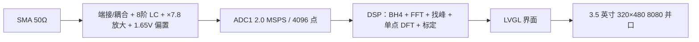

# G2026 — 周期信号测量分析装置

> 面向 10 kHz～500 kHz 周期信号的测量分析装置：**50 Ω 端接 + 8 阶抗混叠 + 2.0 MSPS 采样 +
> 单点 DFT 精化 + LVGL 界面**，在一块自研两层底板上完成从模拟前端到屏幕显示的完整链路。


| 指标 | 要求 | 实测最坏值 | 结论 |
|---|---|---|---|
| 基频误差 | ≤ 1 kHz | **0 Hz** | 满足 |
| 峰峰值误差 | ≤ 5 mV | **1.9 mV** | 满足（余量 2.6×） |
| 有效值误差 | ≤ 5 mV | **0.8 mV** | 满足（余量 6.3×） |
| 频率分辨率 | ≤ 500 Hz | **488.28 Hz** | 满足 |
| 单次测量 | ≤ 2 s | **约 0.25 s** | 满足（余量 8×） |
| 抗干扰 | 1 MHz / 200 mVpp | 带内**仅 2 根谱线** | 满足 |

> 测试口径：官方三组信号 + 11 项边界/组合场景 + 6 点干扰矩阵，共 14+6 项全部 PASS。
> 原始记录见 [`test-record/G2026-上板测试单-20261016-v5.xlsx`](test-record/G2026-上板测试单-20261016-v5.xlsx)。

## 技术栈（每条都能点开核对）

| 方向 | 具体技术 | 证据 |
|---|---|---|
| 嵌入式 C / 裸机 | STM32F407VGT6、时钟树 144 MHz（HSE+PLL）、ADC+DMA、TIM8 触发、FSMC、I²C、SPI | [`board_config.h`](firmware/Core/Inc/board_config.h) |
| 实时系统 | FreeRTOS 三任务、优先级设计（UI > Engine）、信号量 / 任务通知 / 1 深 mailbox | [`app_rtos.c`](firmware/Task/Src/app_rtos.c) · [`app_tasks.c`](firmware/Task/Src/app_tasks.c) |
| 数字信号处理 | 4096 点 CFFT（CMSIS-DSP）、BH4 窗、门限找峰、单点 DFT、17 点对数频标定 | [`op_dsp.c`](firmware/Operation/Src/op_dsp.c) · [`op_peak.c`](firmware/Operation/Src/op_peak.c) |
| 显示与 UI | LVGL 9.5、8080 16 位并口、分块刷新、页面按需建销、触摸中断门控 | [`app_lvgl.c`](firmware/Task/Src/app_lvgl.c) · [`app_ui.c`](firmware/Task/Src/app_ui.c) |
| 模拟电路 | 8 阶无源 LC 巴特沃斯、OPA2197 两级放大、1.65 V 偏置、单点接地 | [`G2026-AFE.pdf`](hardware/sch/G2026-AFE.pdf) · [`G2026-INT.pdf`](hardware/sch/G2026-INT.pdf) |
| 工程化 | 四层架构、编译期隔离（Operation 禁 HAL/RTOS）、主机侧单测、五道构建门禁 | [`fw.py`](firmware/Tools/fw.py) · [`CMakeLists.txt`](firmware/CMakeLists.txt) |
| 测试与度量 | 官方三式 + 11 项边界 + 6 点干扰矩阵，误差按 RSS 分解 | [`测试单`](test-record/G2026-上板测试单-20261016-v5.xlsx) |

> 这些不是关键词：每行都指向能打开的文件。面试时可从任意一行展开到实现细节与取舍。

## 系统一览



- **硬件**：STM32F407VGT6 核心板 + 自研两层底板；模拟/数字分区、AGND 独立岛、单点接地；
  21 只 33 Ω 源端阻尼贴 MCU 侧 2.5～2.9 mm。
- **软件**：Task / Operation / Device / Common 四层，业务逻辑不碰 HAL，可在 PC 上单元测试；
  FreeRTOS 三任务 + 1 深 mailbox；采样窗内 FSMC 零动作。
- **算法**：去均值 → BH4 窗 → 4096 点 CFFT → 门限找峰 → 抛物线/三点/单点 DFT 三步精化 →
  17 点对数频标定；`Upp` 用零相位重建，`Urms` 用 `√(ΣA²/2)`。

## 目录结构

| 位置 | 内容 |
|---|---|
| [`hardware/sch/`](hardware/sch/) | 原理图 PDF：`G2026-AFE.pdf`（模拟前端）、`G2026-INT.pdf`（接口/数字） |
| [`firmware/`](firmware/) | 四层固件工程（CubeMX + CMake + FreeRTOS + LVGL）+ 规范手册 `firmware/docs/00~13` |
| [`test-record/`](test-record/) | 上板测试单（官方三式 + T1～T11 + J1～J6 原始记录） |

进门先读：[`firmware/README.md`](firmware/README.md)（分层与构建）→ [`hardware/sch/`](hardware/sch/)（模拟前端与接口原理图）。

## 快速开始（固件）

```bash
python firmware/Tools/fw.py env      # 工具链 / 探针 / 器件体检
python firmware/Tools/fw.py build    # 编译（--clean-first 为零告警口径）
python firmware/Tools/fw.py flash    # J-Link SWD 烧录
python firmware/Tools/fw.py rtt      # RTT 日志
python firmware/Tools/fw.py verify   # 门禁 + 烧录 + 抓标记，退出码即结论
```

不接板也能验证业务逻辑：

```bash
python firmware/Tools/fw.py test     # Operation 层 PC 侧单测
```

## 测试记录与文档说明

- **上板测试单**：[`test-record/G2026-上板测试单-20261016-v5.xlsx`](test-record/G2026-上板测试单-20261016-v5.xlsx)
  —— 官方三式、T1～T11、J1～J6 的逐项记录，含判据与结论。
- **固件规范**：`firmware/docs/00~13` —— 分层规则、构建门禁、日志与测试约定。
- **原理图**：`hardware/sch/` 两份 PDF，对应模拟前端与接口/数字部分。

毕业设计报告、软硬件导读讲义与补测清单不随本仓库公开（`docs/` 已排除，见 `.gitignore`）；
BOM、PCB 审查与结构文档同样未收录。如需报告或复算明细，可通过 Issue 联系。

## 状态与边界

- ✅ **已上板验证**：显示、触摸、采样、算法、干扰抑制、测量时延。
- ⚠️ **未闭环项**：温漂与长时稳定性未测；三音以上与节点级波形未验证。
- 📄 本仓库为**公开版**：仅保留固件源码、原理图与测试单；内部文档（`docs/`）、BOM/PCB 审查、
  结构文档、`tools/`、AI 规则文件与厂商资料包均未收录。

## 仓库规范

| 文件 | 作用 |
|---|---|
| [`LICENSE`](LICENSE) | 原创代码与文档采用 MIT |
| [`THIRD_PARTY.md`](THIRD_PARTY.md) | ST HAL / CMSIS / FreeRTOS / LVGL / RTT 的许可归属 |
| [`.gitattributes`](.gitattributes) | 行尾统一 LF，PDF/PNG/STL/XLSX 按二进制处理 |

## 许可

原创代码与文档采用 [MIT](LICENSE)。第三方组件（ST HAL、CMSIS、FreeRTOS、LVGL、SEGGER RTT、
字体）版权归各自所有者，详见 [`THIRD_PARTY.md`](THIRD_PARTY.md)。
