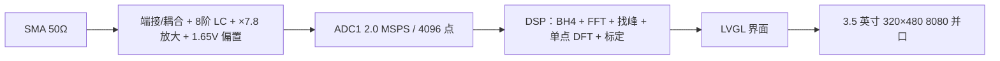
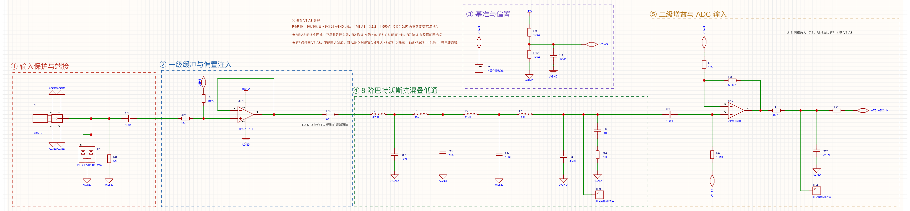

# G2026 — 周期信号测量分析装置

> 面向 10 kHz～500 kHz 周期信号的测量分析装置：**50 Ω 端接 + 8 阶抗混叠 + 2.0 MSPS 采样 +
> 单点 DFT 精化 + LVGL 界面**，在一块底板上完成从模拟前端到屏幕显示的完整链路。


| 指标 | 要求 | 实测最坏值 | 结论 |
|---|---|---|---|
| 基频误差 | ≤ 1 kHz | **0 Hz** | 满足 |
| 峰峰值误差 | ≤ 5 mV | **1.9 mV** | 满足（余量 2.6×） |
| 有效值误差 | ≤ 5 mV | **0.8 mV** | 满足（余量 6.3×） |
| 频率分辨率 | ≤ 500 Hz | **488.28 Hz** | 满足 |
| 单次测量 | ≤ 2 s | **约 0.25 s** | 满足（余量 8×） |
| 抗干扰 | 1 MHz / 200 mVpp | 带内**仅 2 根谱线** | 满足 |

> 测试口径：官方三组信号 + 11 项边界/组合场景 + 6 点干扰矩阵，共 14+6 项全部 PASS。
> 原始记录见 [`test-record/G2026-上板测试单-20261016-v6.xlsx`](test-record/G2026-上板测试单-20261016-v6.xlsx)。

## 技术栈（每条都能点开核对）

| 方向 | 具体技术 | 证据 |
|---|---|---|
| 嵌入式 C / 裸机 | STM32F407VGT6、时钟树 144 MHz（HSE+PLL）、ADC+DMA、TIM8 触发、FSMC、I²C、SPI | [`board_config.h`](firmware/Core/Inc/board_config.h) |
| 实时系统 | FreeRTOS 三任务、优先级设计（UI > Engine）、信号量 / 任务通知 / 1 深 mailbox | [`app_rtos.c`](firmware/Task/Src/app_rtos.c) · [`app_tasks.c`](firmware/Task/Src/app_tasks.c) |
| 数字信号处理 | 4096 点 CFFT（CMSIS-DSP）、BH4 窗、门限找峰、单点 DFT、20 点频标定（顶段加密） | [`op_dsp.c`](firmware/Operation/Src/op_dsp.c) · [`op_peak.c`](firmware/Operation/Src/op_peak.c) |
| 显示与 UI | LVGL 9.5、8080 16 位并口、分块刷新、页面按需建销、触摸中断门控 | [`app_lvgl.c`](firmware/Task/Src/app_lvgl.c) · [`app_ui.c`](firmware/Task/Src/app_ui.c) |
| 模拟电路 | 8 阶无源 LC 巴特沃斯、OPA2197 两级放大、1.65 V 偏置、单点接地 | [`G2026-AFE.png`](hardware/sch/G2026-AFE.png) · [`G2026-INT.png`](hardware/sch/G2026-INT.png) |
| 工程化 | 四层架构、编译期隔离（Operation 禁 HAL/RTOS）、主机侧单测、五道构建门禁 | [`fw.py`](firmware/Tools/fw.py) · [`CMakeLists.txt`](firmware/CMakeLists.txt) |
| 测试与度量 | 官方三式 + 11 项边界 + 6 点干扰矩阵，误差按 RSS 分解 | [`测试单`](test-record/G2026-上板测试单-20261016-v6.xlsx) |

> 这些不是关键词：每行都指向能打开的文件。面试时可从任意一行展开到实现细节与取舍。

## 系统一览



- **硬件**：STM32F407VGT6 核心板 + 自研两层底板；模拟/数字分区、AGND 独立岛、单点接地；
  21 只 33 Ω 源端阻尼贴 MCU 侧 2.5～2.9 mm。
- **软件**：Task / Operation / Device / Common 四层，业务逻辑不碰 HAL，可在 PC 上单元测试；
  FreeRTOS 三任务 + 1 深 mailbox；采样窗内 FSMC 零动作。
- **算法**：去均值 → BH4 窗 → 4096 点 CFFT → 门限找峰 → 抛物线/三点/单点 DFT 三步精化 →
  20 点频标定（16 点对数 + 顶段 391.5k→500k 四等分）；`Upp` 用零相位重建，`Urms` 用 `√(ΣA²/2)`。

### 模拟前端：五级链路



| 级 | 电路 | 作用 | 关键数值 |
|---|---|---|---|
| ① 输入保护与端接 | `J1` SMA + `R1` 49.9 Ω + `D1` | 50 Ω 端接、过压钳位 | 源 100 mVpp → **50 mVpp**（×0.5） |
| ② 一级缓冲与偏置注入 | `U1A` 跟随器、`C1` 100 nF | 高阻隔离，负载不回打到源 | 入 ≈ 出，直流抬到 **1.65 V** |
| ③ 基准与偏置 | 分压 + 去耦 → `VBIAS`（`TP5`） | 给单电源 ADC 定量程中点 | **1.650 V** |
| ④ 8 阶巴特沃斯抗混叠低通 | 无源 LC 梯形（L 4.7/22/22/15 µH，C 6.8/10/10/2.2 nF） | 唯一能压住 1 MHz 干扰的环节，数字侧补不回来 | 10 kHz 入 50 → 出 **25 mVpp**（−6.02 dB）；1 MHz/200 mVpp 带内只剩 2 根谱线 |
| ⑤ 二级增益与 ADC 输入 | `U1B` ×7.8 + `R11` 300 Ω / `C10` 470 pF | 抬到 ADC 量程，输出 RC 再补一刀 | 25 → **195 mVpp**；500 kHz 处再低 0.8 dB |

> 图为立创EDA 直接导出的原图（4441×1032），点开可放大看位号与参数。EDA 自带的 PDF 导出
> 未嵌入字体（位号与参数画不出来），所以原理图只收 PNG。

## 目录结构

| 位置 | 内容 |
|---|---|
| [`hardware/sch/`](hardware/sch/) | 原理图 PNG：`G2026-AFE.png`（模拟前端，4441×1032）、`G2026-INT.png`（接口/数字，2522×2101） |
| [`firmware/`](firmware/) | 四层固件工程（CubeMX + CMake + FreeRTOS + LVGL）+ 规范手册 `firmware/docs/00~13` |
| [`test-record/`](test-record/) | 上板测试单（官方三式 + T1～T11 + J1～J6 原始记录） |

进门先读：[`firmware/README.md`](firmware/README.md)（分层与构建）→ [`hardware/sch/`](hardware/sch/)（模拟前端与接口原理图）。

## 快速开始（固件）

```bash
python firmware/Tools/fw.py env      # 工具链 / 探针 / 器件体检
python firmware/Tools/fw.py build    # 编译（--clean-first 为零告警口径）
python firmware/Tools/fw.py flash    # J-Link SWD 烧录
python firmware/Tools/fw.py rtt      # RTT 日志
python firmware/Tools/fw.py verify   # 门禁 + 烧录 + 抓标记，退出码即结论
```

不接板也能验证业务逻辑：

```bash
python firmware/Tools/fw.py test     # Operation 层 PC 侧单测
```

## 测试记录与文档说明

- **上板测试单**：[`test-record/G2026-上板测试单-20261016-v6.xlsx`](test-record/G2026-上板测试单-20261016-v6.xlsx)
  —— 两张表：测试矩阵（官方三式 + T1～T11，14 项）、干扰矩阵（J1～J6，6 项），逐项含判据与结论，20/20 PASS。
- **固件规范**：`firmware/docs/00~13` —— 分层规则、构建门禁、日志与测试约定。
- **原理图**：`hardware/sch/` 两张 PNG —— 模拟前端 `G2026-AFE.png`、接口/数字 `G2026-INT.png`。

毕业设计报告、软硬件导读讲义与补测清单不随本仓库公开（`docs/` 已排除，见 `.gitignore`）；
BOM、PCB 审查与结构文档同样未收录。如需报告或复算明细，可通过 Issue 联系。


## 仓库规范

| 文件 | 作用 |
|---|---|
| [`LICENSE`](LICENSE) | 原创代码与文档采用 MIT |
| [`THIRD_PARTY.md`](THIRD_PARTY.md) | ST HAL / CMSIS / FreeRTOS / LVGL / RTT 的许可归属 |
| [`.gitattributes`](.gitattributes) | 行尾统一 LF，PDF/PNG/STL/XLSX 按二进制处理 |

## 许可

原创代码与文档采用 [MIT](LICENSE)。第三方组件（ST HAL、CMSIS、FreeRTOS、LVGL、SEGGER RTT、
字体）版权归各自所有者，详见 [`THIRD_PARTY.md`](THIRD_PARTY.md)。
